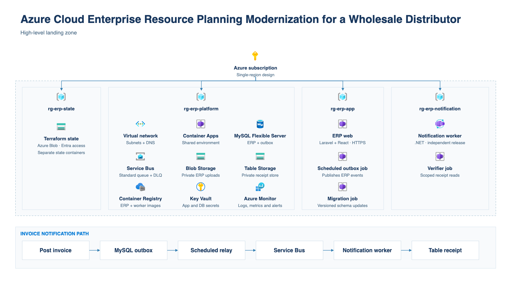
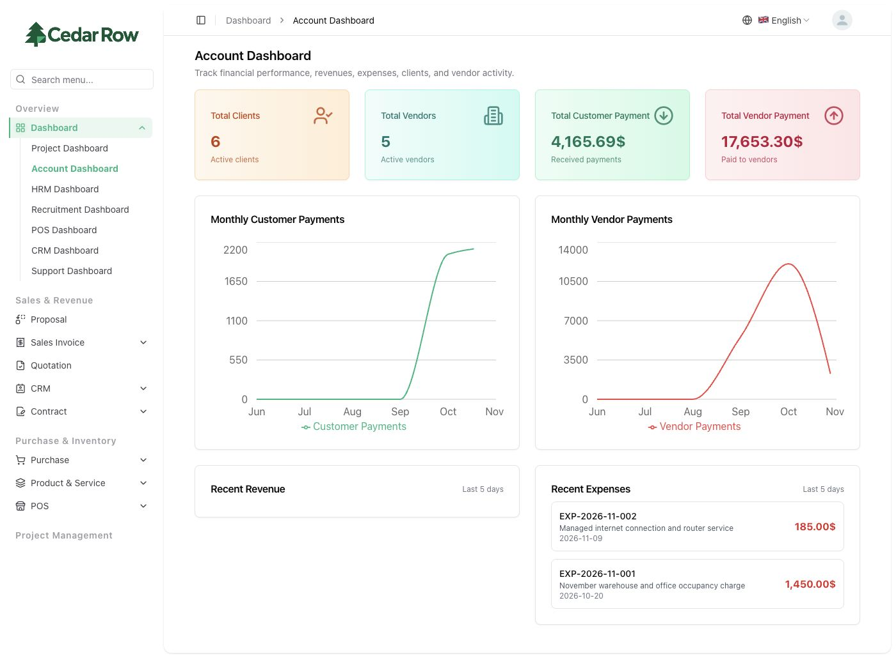
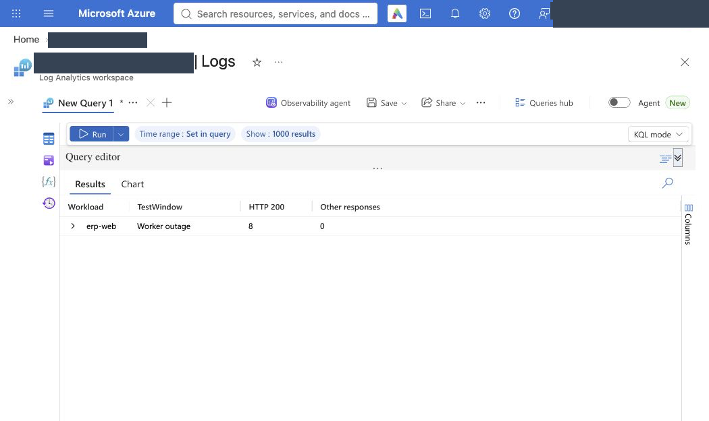
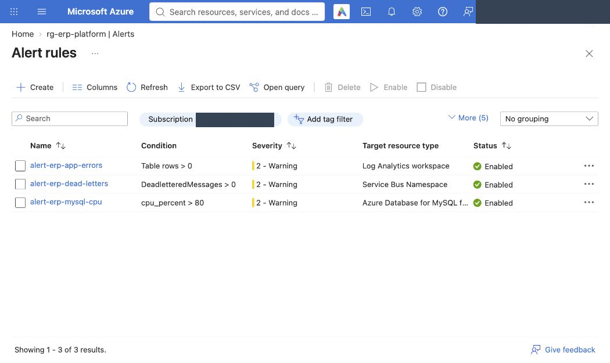
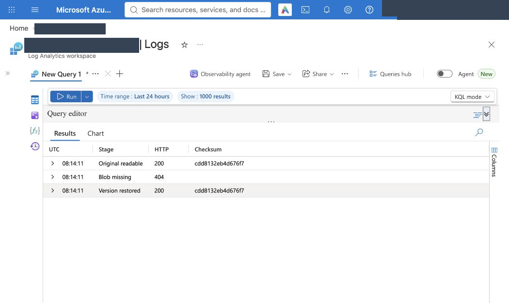

# Azure Cloud Enterprise Resource Planning Modernization with Monitoring and Disaster Recovery

## Executive summary

Cedar Row Office Supply is a fictional wholesaler whose offices originally shared one on-premises ERP server. An outage could stop invoicing and leave staff without current stock counts. I moved the ERP to Azure with Terraform. The live ERP and its separate notification worker run on Azure Container Apps with managed MySQL and Service Bus. Invoicing continued during the worker outage drill. The recovery drills restored a deleted file and isolated MySQL records.

[Business context](#business-context) · [Business problem](#business-problem) · [My contribution](#my-contribution) · [Landing zone](#landing-zone) · [Architecture diagrams](#architecture-diagrams) · [Deployment validation](#deployment-validation) · [Live ERP showcase](#live-erp-showcase) · [Deployment evidence](#deployment-evidence) · [Data recovery drills](#data-recovery-drills)

## Business context

Cedar Row Office Supply is a fictional Toronto wholesaler with several sales offices and a shared warehouse. It sells paper, toner, and other office supplies to local businesses. Staff across the company rely on one ERP to check what is in stock, post invoices, and keep sales and accounting records in sync.

## Business problem

In this scenario, Cedar Row originally ran its ERP and database on one physical server at the warehouse. A hardware failure, power outage, or maintenance could cut off every office at once. Losing access to stock counts and invoices put shipments and payments at risk.

I moved the ERP and its database to Azure and deployed notifications as a separate workload. This took the offices off the shared warehouse server and let staff keep invoicing while the notification worker was paused. I configured database backups and blob versioning to give Cedar Row a way to recover its records and uploads.

## My contribution

- I designed the Azure infrastructure and set up private access to the database and file storage.
- I used Terraform to deploy the ERP and its separate notification service to Azure.
- I set up monitoring and tested that invoicing continued when the notification service went down.
- I configured backups and tested recovery for deleted files and database records.

## Landing zone

The ERP web app has restricted HTTPS access. The worker runs in the same Container Apps environment without public ingress. Both have their own release paths. The network, data services, registry, secrets, and monitoring live in the shared platform resource group.

[Editable draw.io file](docs/architecture/Azure-ERP-Architecture.drawio) · [Seven-page PDF](docs/architecture/Azure-ERP-Architecture.pdf) · [Architecture notes](docs/architecture/README.md) · [Terraform](terraform/README.md)

## Architecture diagrams

| View | What it shows |
| --- | --- |
| [Landing zone](docs/architecture/01-overview.png) | Four resource groups and the invoice notification path. |
| [Network and ingress](docs/architecture/02-network.png) | HTTPS entry, delegated subnets, and private data paths. |
| [Invoice notifications](docs/architecture/03-event.png) | The invoice transaction, queue, receipt, and failure handling. |
| [Identity and ownership](docs/architecture/04-access.png) | The permissions each workload needs and the identities used for releases. |
| [Terraform and releases](docs/architecture/05-delivery.png) | The infrastructure build order, separate releases, and rollback points. |
| [Monitoring and alerts](docs/architecture/06-operations.png) | Container logs, invoice tracing, and operational alerts. |
| [Recovery and cleanup](docs/architecture/07-recovery.png) | Isolated database restore, file recovery, and teardown. |

## Deployment validation

The deployment passed the ERP readiness checks during the notification outage and processed the queued invoice event once the worker restarted. The recovery drills restored a deleted blob and isolated MySQL records. [Deployment evidence](#deployment-evidence)

## Live ERP showcase

The Cedar Row ERP is live on Azure. The screenshots show the application in use, and the diagrams explain the services behind it. [Live ERP Deployed Access](https://erp.spiraml.com/)

[Full screenshot walkthrough](docs/live-erp-showcase.md) · [Azure deployment and recovery evidence](#deployment-evidence)

**Staff dashboard.** Finance staff see customer and vendor payments in one place. The browser reaches the ERP on Azure Container Apps over HTTPS, and the app reads business records from MySQL over a private network. [Network diagram](docs/architecture/02-network.png)

**Sales and accounting.** The ledger shows how sales and payments affect accounts and stock. In the Azure deployment, posting an invoice saved the invoice, stock change, accounting entries, and a pending notification event in one MySQL transaction. A separate worker handled notifications through Service Bus, and invoice posting continued during the worker outage drill. [Invoice flow](docs/architecture/03-event.png) · [Outage drill](#notification-outage-and-recovery)

**Inventory.** The item catalog shows the stock counts staff rely on when fulfilling orders. In Azure, those records lived in MySQL and uploads used private Blob Storage. I recovered a deleted file and checked a logical database restore against the original records. [Recovery drills](#data-recovery-drills)

## Deployment evidence

I used Terraform to deploy four Azure resource groups for state, the shared platform, the ERP app, and notifications. The screenshots below document that deployment and its recovery drills.

The receipt storage account has an [approved private endpoint](docs/assets/deployment/private-storage-connection.png).

### Notification outage and recovery

While the notification worker was stopped, the ERP posted a **$30 synthetic invoice** and stock dropped from ten cartons to eight. Azure Monitor recorded **eight HTTP 200 readiness responses** from the ERP during the outage.

Service Bus held one active message during the outage. After the worker restarted, the queue drained and the verifier found one matching receipt.

Log Analytics ties the invoice, the relay’s publish, and the worker’s receipt to the same event ID.

### Azure Monitor alerts

Three alert rules were enabled for application errors, dead-letter messages, and MySQL CPU.

### Data recovery drills

**Azure Blob Storage.** Deleting a synthetic file returned HTTP 404 on read. After its previous version became current, the file returned HTTP 200 and matched the original SHA-256 checksum. [Versioning and retention settings](docs/assets/deployment/blob-data-protection.png)

**Azure MySQL.** Three synthetic records were backed up, deleted from an isolated database, and restored into a second database on the same Azure server. The source remained empty and all three restored rows matched the original checksum. [Backup retention settings](docs/assets/deployment/mysql-backup-retention.png)

