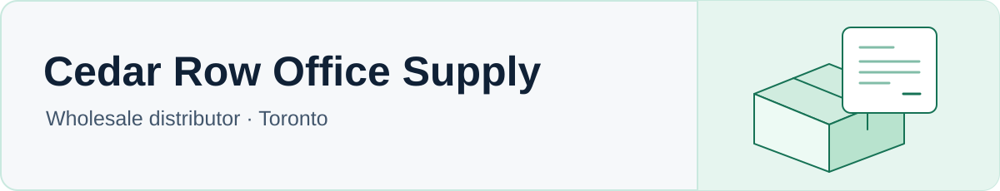
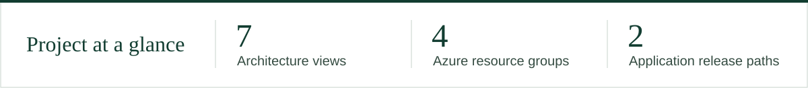

# Azure Enterprise Resource Planning Modernization for a Wholesale Distributor

## Executive summary

I designed an Azure architecture for Cedar Row Office Supply, a fictional wholesaler that sells office supplies to local businesses. Posting an invoice needs to update sales, stock, and accounting together, even if the notification service is unavailable. I used Azure Container Apps, MySQL, and Service Bus in the design so the ERP can record the sale and a separate .NET worker can process the notification later. Implementation and Azure validation are planned.

[Business context](#business-context) · [My contribution](#my-contribution) · [Landing zone](#landing-zone) · [Architecture diagrams](#architecture-diagrams) · [Validation plan](#validation-plan)

## Business context

Cedar Row starts with ten cartons of office paper and sells two at $15 each. When staff post the invoice, the ERP should record a $30 sale, leave eight cartons in stock, and update the accounting records. The customer can pay later. Sales, warehouse, and accounting staff work from the same transaction.

I kept invoice posting and its related stock and accounting changes together in MySQL. The same transaction records an event for the notification. A scheduled Container Apps job publishes that event to Service Bus. The .NET worker processes it and saves a receipt in Azure Table Storage.

## My contribution

- **Application design.** I mapped the invoice flow from posting through stock and accounting updates to a separate notification worker.
- **Azure architecture.** I grouped the Terraform state, shared platform, ERP app, and notification service. I designed private access to MySQL and storage, scoped identities, and monitoring for each step of the invoice flow.
- **Delivery and recovery.** I planned separate releases and rollbacks for the ERP and worker, an isolated database restore, and the checks needed to verify them.

## Landing zone

The ERP web app has restricted HTTPS access. The worker runs in the same Container Apps environment without public ingress. Both have their own release paths. The network, data services, registry, secrets, and monitoring live in the shared platform resource group.

[Editable draw.io file](docs/architecture/Azure-ERP-Architecture.drawio) · [Seven-page PDF](docs/architecture/Azure-ERP-Architecture.pdf) · [Design notes](docs/architecture/README.md)

## Architecture diagrams

| View | What it shows |
| --- | --- |
| [Landing zone](docs/architecture/01-overview.png) | The subscription, four resource groups, and invoice notification path. |
| [Network and ingress](docs/architecture/02-network.png) | HTTPS entry, delegated subnets, and private data paths. |
| [Invoice notifications](docs/architecture/03-event.png) | The invoice transaction, queue, receipt, and failure handling. |
| [Identity and ownership](docs/architecture/04-access.png) | The permissions each workload needs and the identities used for releases. |
| [Terraform and releases](docs/architecture/05-delivery.png) | The infrastructure build order, separate releases, and rollback points. |
| [Monitoring and alerts](docs/architecture/06-operations.png) | Container logs, invoice tracing, and operational alerts. |
| [Recovery and cleanup](docs/architecture/07-recovery.png) | Isolated database restore, file recovery, and teardown. |

## Validation plan

1. Post the sample invoice locally and check the total, remaining stock, and accounting entries.
2. Pause the notification worker in Azure. Post another invoice and verify it succeeds. Restart the worker and trace the event to its receipt.
3. Deliver the same event twice and verify that it produces one receipt.
4. Roll back the ERP and worker independently. Restore MySQL to a separate server and verify the restored records before teardown.

The repository currently contains the design and its validation plan.
