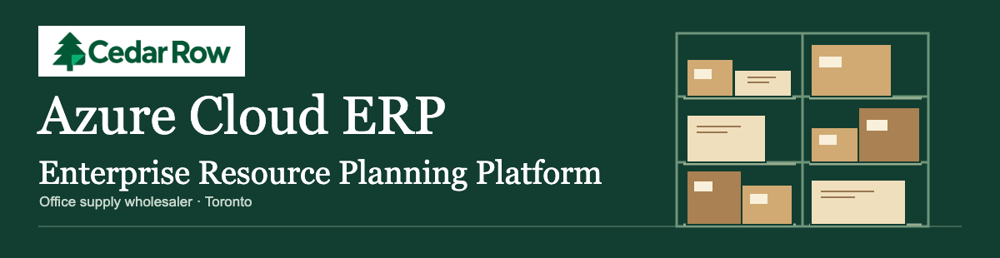
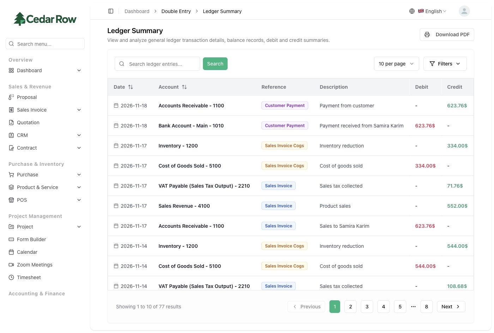

# Azure Cloud Enterprise Resource Planning Modernization with Monitoring and Disaster Recovery

## Executive summary

I designed this project for Cedar Row Office Supply, a fictional wholesaler with several branches and a shared warehouse. Employees depend on one ERP for sales, stock, accounting, customer relationship management (CRM), and human resource management (HRM). A failure on the original warehouse server could interrupt work across every branch, so Cedar Row needed a way to keep key operations running and recover its records.

I deployed the ERP and a separate notification worker on Azure with Terraform, using Container Apps, managed MySQL, and Service Bus. I tested that invoicing continued while the worker was down. I also restored a deleted file and isolated MySQL records.

  

[Business context](#business-context) · [Business problem](#business-problem) · [My contribution](#my-contribution) · [Landing zone](#landing-zone) · [Architecture diagrams](#architecture-diagrams) · [Deployment results](#deployment-results) · [Live ERP showcase](#live-erp-showcase) · [Deployment evidence](#deployment-evidence) · [Data recovery drills](#data-recovery-drills)

## Business context

I based the project on a Toronto office supply wholesaler with several sales offices and a shared warehouse. Staff use the ERP to check stock, post invoices, and keep sales and accounting records in sync across offices.

The ERP includes customer relationship management (CRM) for sales and customer follow-up, and human resource management (HRM) for staffing, attendance, and leave.

## Business problem

Cedar Row originally ran its ERP and database on one physical server at the warehouse. A hardware failure, power outage, or maintenance could cut off every office at once. Losing access to stock counts and invoices put shipments and payments at risk.

I moved the ERP and its database to Azure and deployed the notification worker separately. I configured database backups and versioning for uploaded files.

## My contribution

- I designed the Azure infrastructure and set up private access to the database and file storage.
- I used Terraform to deploy the ERP and its separate notification service to Azure.
- I set up monitoring and tested that invoicing continued when the notification service went down.
- I configured backups and tested recovery for deleted files and database records.

## Landing zone

The ERP web app has restricted HTTPS access. The worker runs in the same Container Apps environment without public ingress. Both have their own release paths. The network, data services, registry, secrets, and monitoring live in the shared platform resource group.

[Editable draw.io file](docs/architecture/Azure-ERP-Architecture.drawio) · [Seven-page PDF](docs/architecture/Azure-ERP-Architecture.pdf) · [Architecture notes](docs/architecture/README.md) · [Terraform](terraform/README.md)

## Architecture diagrams

| View | What it shows |
| --- | --- |
| [Landing zone](docs/architecture/01-overview.png) | Four resource groups and the invoice notification path. |
| [Network and ingress](docs/architecture/02-network.png) | HTTPS entry, delegated subnets, and private data paths. |
| [Invoice notifications](docs/architecture/03-event.png) | The invoice transaction, queue, receipt, and failure handling. |
| [Identity and ownership](docs/architecture/04-access.png) | The permissions each workload needs and the identities used for releases. |
| [Terraform and releases](docs/architecture/05-delivery.png) | The infrastructure build order, separate releases, and rollback points. |
| [Monitoring and alerts](docs/architecture/06-operations.png) | Container logs, invoice tracing, and operational alerts. |
| [Recovery and cleanup](docs/architecture/07-recovery.png) | MySQL restore steps, file recovery, and cleanup order. |

## Deployment results

The ERP stayed ready while the notification worker was stopped. When the worker restarted, it processed the queued invoice event. I restored a deleted file and matched the recovered MySQL rows to the original records. [Deployment evidence](#deployment-evidence)

## Live ERP showcase

The Cedar Row ERP is live on Azure. [Live ERP Deployed Access](https://erp.spiraml.com/)

[Full screenshot walkthrough](docs/live-erp-showcase.md) · [Azure deployment and recovery evidence](#deployment-evidence)

**Staff dashboard.** Finance staff see customer and vendor payments in one place. The browser reaches the ERP on Azure Container Apps over HTTPS, and the app reads business records from MySQL over a private network. [Network diagram](docs/architecture/02-network.png)

**Sales and accounting.** The ledger shows how sales and payments affect accounts and stock. The ERP saves the invoice, stock change, accounting entries, and notification event in one MySQL transaction. A separate worker handles notifications through Service Bus. Invoice posting continued during the worker outage drill. [Invoice flow](docs/architecture/03-event.png) · [Outage drill](#notification-outage-and-recovery)

**Inventory.** The catalog shows what stock is on hand. MySQL stores the inventory records, and Azure Blob Storage holds uploads. I restored a deleted file and checked the recovered database records against the originals. [Recovery drills](#data-recovery-drills)

## Deployment evidence

I used Terraform to deploy four Azure resource groups for state, the shared platform, the ERP app, and notifications.

The receipt storage account has an [approved private endpoint](docs/assets/deployment/private-storage-connection.png).

### Notification outage and recovery

While the notification worker was stopped, the ERP posted a **$30 synthetic invoice** and stock dropped from ten cartons to eight. Azure Monitor recorded **eight HTTP 200 readiness responses** from the ERP during the outage.

Service Bus held one active message during the outage. After the worker restarted, the queue drained and the verifier found one matching receipt.

Log Analytics shows the same event ID for invoice posting, the relay publishing it to Service Bus, and the worker recording the receipt.

### Azure Monitor alerts

I enabled three alert rules for application errors, dead-letter messages, and MySQL CPU.

### Data recovery drills

**Azure Blob Storage.** Deleting a synthetic file returned HTTP 404 on read. After its previous version became current, the file returned HTTP 200 and matched the original SHA-256 checksum. [Versioning and retention settings](docs/assets/deployment/blob-data-protection.png)

**Azure MySQL.** Three synthetic records were backed up, deleted from an isolated database, and restored into a second database on the same Azure server. The source remained empty and all three restored rows matched the original checksum. [Backup retention settings](docs/assets/deployment/mysql-backup-retention.png)

