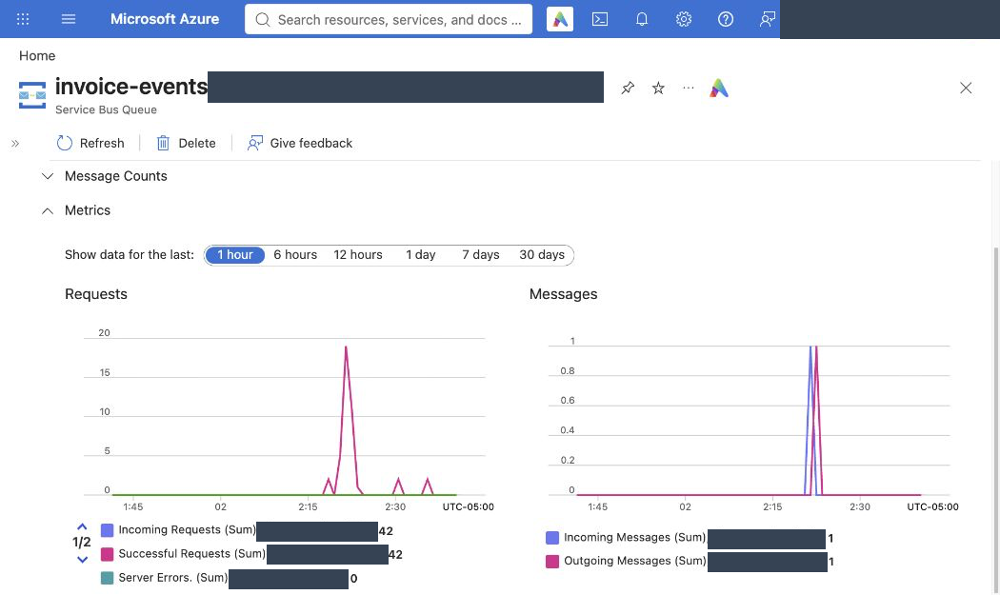

# Azure Cloud Enterprise Resource Planning Modernization with Monitoring and Disaster Recovery

## Executive summary

Cedar Row Office Supply is a fictional wholesaler whose offices share one on-premises ERP server. If that server goes down, invoicing stops and shipments can be delayed. I deployed the ERP and its separate notification worker with Terraform on Azure Container Apps, using managed MySQL and Service Bus. The deployment drills verified that invoicing continued during a worker outage and that a deleted file and synthetic MySQL records could be recovered.

[Business context](#business-context) · [Business problem](#business-problem) · [My contribution](#my-contribution) · [Landing zone](#landing-zone) · [Architecture diagrams](#architecture-diagrams) · [Validation plan](#validation-plan) · [Deployment evidence](#deployment-evidence) · [Data recovery drills](#data-recovery-drills)

## Business context

Cedar Row Office Supply is a fictional Toronto wholesaler with several sales offices and a shared warehouse. It sells paper, toner, and other office supplies to local businesses. Staff across the company rely on one ERP to check what is in stock, post invoices, and keep sales and accounting records in sync.

## Business problem

In this scenario, Cedar Row runs its ERP and database on one physical server at the warehouse. A hardware failure, a power outage at the warehouse, or maintenance on that server can cut off every office at once. Sales staff lose access to live stock counts, the warehouse can miss shipments, and delayed invoices can slow down payments.

Cedar Row needs the ERP to stay available during business hours and a way to recover its records after a serious outage. I designed the move to Azure to take the ERP off the warehouse hardware, keep invoicing running if the notification worker fails, and use managed database backups. The disaster recovery plan restores the database to a separate server and checks invoices, stock, and accounting records before staff resume work.

## My contribution

- **Application design.** I mapped the invoice flow from posting through stock and accounting updates to a separate notification worker.
- **Azure architecture.** I grouped the Terraform state, shared platform, ERP app, and notification service. I designed private access to MySQL and storage, scoped identities, and monitoring for each step of the invoice flow.
- **Delivery and recovery.** I planned separate releases and rollbacks for the ERP and worker, an isolated database restore, and the checks needed to verify them.

## Landing zone

The ERP web app has restricted HTTPS access. The worker runs in the same Container Apps environment without public ingress. Both have their own release paths. The network, data services, registry, secrets, and monitoring live in the shared platform resource group.

[Editable draw.io file](docs/architecture/Azure-ERP-Architecture.drawio) · [Seven-page PDF](docs/architecture/Azure-ERP-Architecture.pdf) · [Design notes](docs/architecture/README.md) · [Terraform](terraform/README.md)

## Architecture diagrams

| View | What it shows |
| --- | --- |
| [Landing zone](docs/architecture/01-overview.png) | Four resource groups and the invoice notification path. |
| [Network and ingress](docs/architecture/02-network.png) | HTTPS entry, delegated subnets, and private data paths. |
| [Invoice notifications](docs/architecture/03-event.png) | The invoice transaction, queue, receipt, and failure handling. |
| [Identity and ownership](docs/architecture/04-access.png) | The permissions each workload needs and the identities used for releases. |
| [Terraform and releases](docs/architecture/05-delivery.png) | The infrastructure build order, separate releases, and rollback points. |
| [Monitoring and alerts](docs/architecture/06-operations.png) | Container logs, invoice tracing, and operational alerts. |
| [Recovery and cleanup](docs/architecture/07-recovery.png) | Isolated database restore, file recovery, and teardown. |

## Validation plan

The [deployment evidence](#deployment-evidence) shows the notification outage and data recovery drills. The [recovery design](docs/architecture/07-recovery.png) also covers restoring MySQL to a separate server before cutover.

## Deployment evidence

I used Terraform to deploy four resource groups for state, the shared platform, the ERP app, and notifications.

The receipt storage account has an [approved private endpoint](docs/assets/deployment/private-storage-connection.png).

### Notification outage and recovery

While the notification worker was stopped, the ERP posted a **$30 demo invoice** and stock dropped from ten cartons to eight. Azure Monitor recorded **eight HTTP 200 readiness responses** from the ERP during the outage.

Service Bus held one active message during the outage. After the worker restarted, the queue drained and the verifier found one matching receipt.

Log Analytics ties the invoice, the relay’s publish, and the worker’s receipt to the same event ID.

### Azure Monitor alerts

Three alert rules were enabled for application errors, dead-letter messages, and MySQL CPU.

### Data recovery drills

**Azure Blob Storage.** Deleting a synthetic file returned HTTP 404 on read. After its previous version became current, the file returned HTTP 200 and matched the original SHA-256 checksum. [Versioning and retention settings](docs/assets/deployment/blob-data-protection.png)

**Azure MySQL.** Three synthetic records were backed up, deleted from an isolated database, and restored into a second database on the same Azure server. The source remained empty and all three restored rows matched the original checksum. [Backup retention settings](docs/assets/deployment/mysql-backup-retention.png)

Azure still reported **Accepted** for a separate managed MySQL point-in-time restore at the 75-minute check. The verified MySQL result above is from the logical restore.
