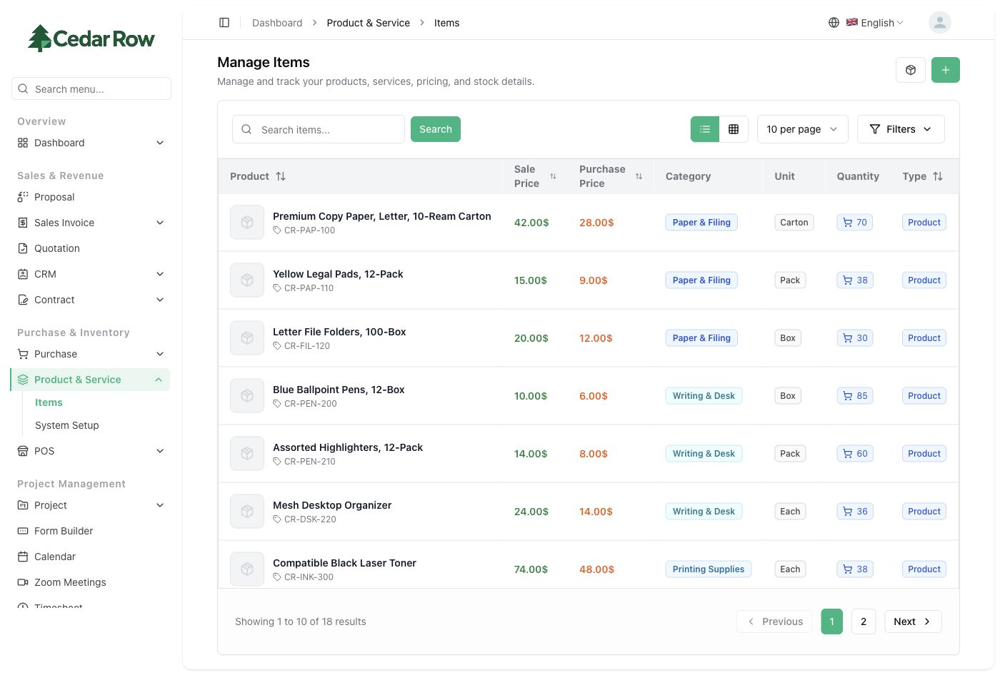
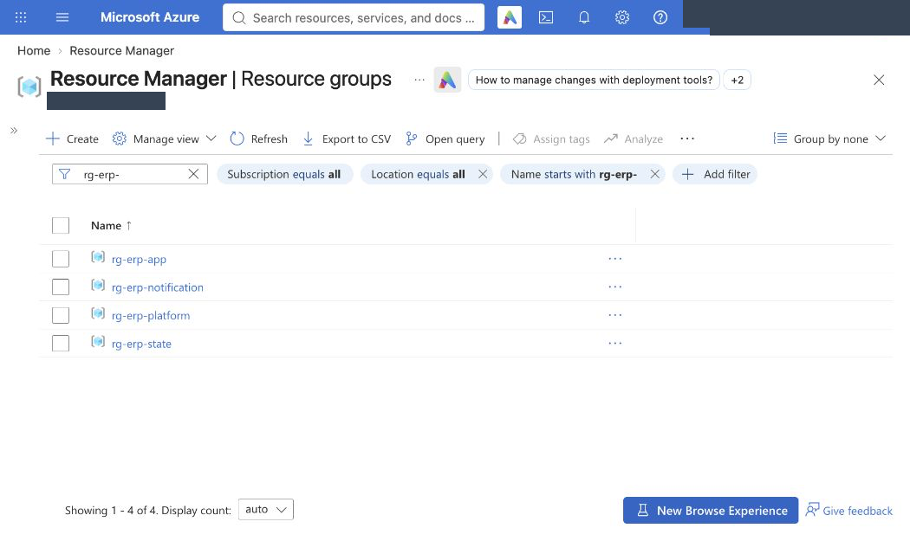
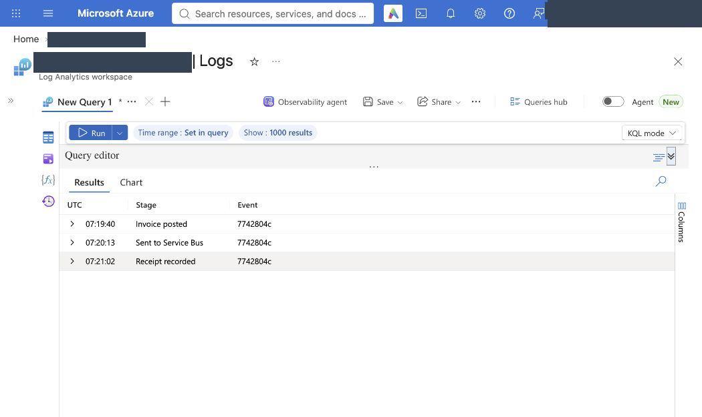
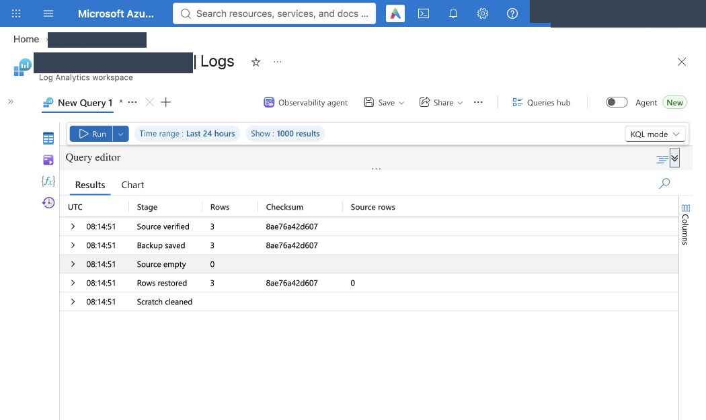

# Azure Cloud Enterprise Resource Planning Modernization with Monitoring and Disaster Recovery

## Executive summary

Cedar Row Office Supply is a fictional wholesaler whose offices share one on-premises ERP server. If that server goes down, invoicing stops and shipments can be delayed. I deployed the ERP and its separate notification worker with Terraform on Azure Container Apps, using managed MySQL and Service Bus. The deployment drills verified that invoicing continued during a worker outage and that a deleted file and synthetic MySQL records could be recovered.

[Business context](#business-context) · [Business problem](#business-problem) · [My contribution](#my-contribution) · [Landing zone](#landing-zone) · [Architecture diagrams](#architecture-diagrams) · [Validation plan](#validation-plan) · [Live ERP showcase](#live-erp-showcase) · [Deployment evidence](#deployment-evidence) · [Data recovery drills](#data-recovery-drills)

## Business context

Cedar Row Office Supply is a fictional Toronto wholesaler with several sales offices and a shared warehouse. It sells paper, toner, and other office supplies to local businesses. Staff across the company rely on one ERP to check what is in stock, post invoices, and keep sales and accounting records in sync.

## Business problem

In this scenario, Cedar Row runs its ERP and database on one physical server at the warehouse. A hardware failure, a power outage at the warehouse, or maintenance on that server can cut off every office at once. Sales staff lose access to live stock counts, the warehouse can miss shipments, and delayed invoices can slow down payments.

Cedar Row needs the ERP to stay available during business hours and a way to recover its records after a serious outage. I designed the move to Azure to take the ERP off the warehouse hardware, keep invoicing running if the notification worker fails, and use managed database backups. The disaster recovery plan restores the database to a separate server and checks invoices, stock, and accounting records before staff resume work.

## My contribution

- **Azure deployment.** I pushed both images to Azure Container Registry and deployed the ERP and notification worker to Azure Container Apps with Terraform. I designed separate release and rollback paths for the two workloads.
- **Architecture and security.** I designed the invoice-to-notification flow with Azure Service Bus. I configured private access to MySQL and storage, with managed identities and scoped Key Vault permissions.
- **Monitoring and resilience.** I configured Azure Monitor, Log Analytics, and three alert rules. During the worker outage drill, the ERP posted a $30 invoice and passed all eight readiness checks. After the worker restarted, the queued event produced one verified receipt.
- **Data recovery.** I configured Blob versioning and MySQL backup retention. The drills restored a deleted blob from its previous version and three MySQL rows from a logical backup. Both restores matched the original SHA-256 checksums.

## Landing zone

The ERP web app has restricted HTTPS access. The worker runs in the same Container Apps environment without public ingress. Both have their own release paths. The network, data services, registry, secrets, and monitoring live in the shared platform resource group.

[Editable draw.io file](docs/architecture/Azure-ERP-Architecture.drawio) · [Seven-page PDF](docs/architecture/Azure-ERP-Architecture.pdf) · [Design notes](docs/architecture/README.md) · [Terraform](terraform/README.md)

## Architecture diagrams

| View | What it shows |
| --- | --- |
| [Landing zone](docs/architecture/01-overview.png) | Four resource groups and the invoice notification path. |
| [Network and ingress](docs/architecture/02-network.png) | HTTPS entry, delegated subnets, and private data paths. |
| [Invoice notifications](docs/architecture/03-event.png) | The invoice transaction, queue, receipt, and failure handling. |
| [Identity and ownership](docs/architecture/04-access.png) | The permissions each workload needs and the identities used for releases. |
| [Terraform and releases](docs/architecture/05-delivery.png) | The infrastructure build order, separate releases, and rollback points. |
| [Monitoring and alerts](docs/architecture/06-operations.png) | Container logs, invoice tracing, and operational alerts. |
| [Recovery and cleanup](docs/architecture/07-recovery.png) | Isolated database restore, file recovery, and teardown. |

## Validation plan

The [deployment evidence](#deployment-evidence) shows the notification outage and data recovery drills. The [recovery design](docs/architecture/07-recovery.png) also covers restoring MySQL to a separate server before cutover.

## Live ERP showcase

These screens show the live Cedar Row ERP on a VPS. The linked diagrams and deployment records show how I ran and validated the ERP on Azure. [Live ERP Deployed Access](https://erp.spiraml.com/)

[Full screenshot walkthrough](docs/live-erp-showcase.md) · [Azure deployment and recovery evidence](#deployment-evidence)

**Staff dashboard.** Finance staff see customer and vendor payments in one place. In Azure, the browser reached the ERP on Azure Container Apps over HTTPS, and the app read business records from MySQL over a private network. [Network diagram](docs/architecture/02-network.png)

**Sales and accounting.** The ledger shows how sales and payments affect accounts and stock. In the Azure deployment, posting an invoice saved the invoice, stock change, accounting entries, and a pending notification event in one MySQL transaction. A separate worker handled notifications through Service Bus, and invoice posting continued during the worker outage drill. [Invoice flow](docs/architecture/03-event.png) · [Outage drill](#notification-outage-and-recovery)

**Inventory.** The item catalog shows the stock counts staff rely on when fulfilling orders. In Azure, those records lived in MySQL and uploads used private Blob Storage. I recovered a deleted file and checked a logical database restore against the original records. [Recovery drills](#data-recovery-drills)

## Deployment evidence

I used Terraform to deploy four Azure resource groups for state, the shared platform, the ERP app, and notifications. The screenshots below document that deployment and its recovery drills.

The receipt storage account has an [approved private endpoint](docs/assets/deployment/private-storage-connection.png).

### Notification outage and recovery

While the notification worker was stopped, the ERP posted a **$30 synthetic invoice** and stock dropped from ten cartons to eight. Azure Monitor recorded **eight HTTP 200 readiness responses** from the ERP during the outage.

Service Bus held one active message during the outage. After the worker restarted, the queue drained and the verifier found one matching receipt.

Log Analytics ties the invoice, the relay’s publish, and the worker’s receipt to the same event ID.

### Azure Monitor alerts

Three alert rules were enabled for application errors, dead-letter messages, and MySQL CPU.

### Data recovery drills

**Azure Blob Storage.** Deleting a synthetic file returned HTTP 404 on read. After its previous version became current, the file returned HTTP 200 and matched the original SHA-256 checksum. [Versioning and retention settings](docs/assets/deployment/blob-data-protection.png)

**Azure MySQL.** Three synthetic records were backed up, deleted from an isolated database, and restored into a second database on the same Azure server. The source remained empty and all three restored rows matched the original checksum. [Backup retention settings](docs/assets/deployment/mysql-backup-retention.png)

Azure still reported **Accepted** for a separate managed MySQL point-in-time restore at the 75-minute check. The verified MySQL result above is from the logical restore.
