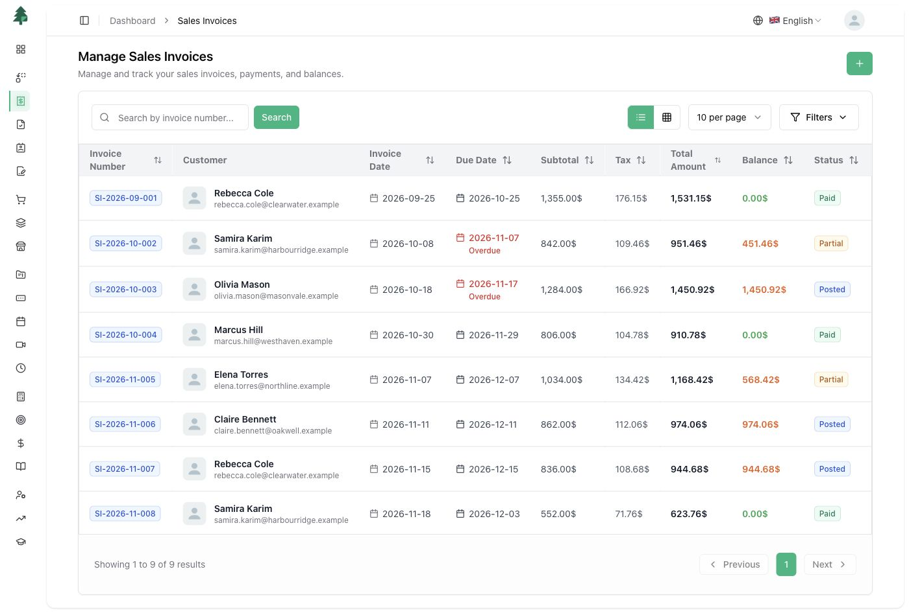
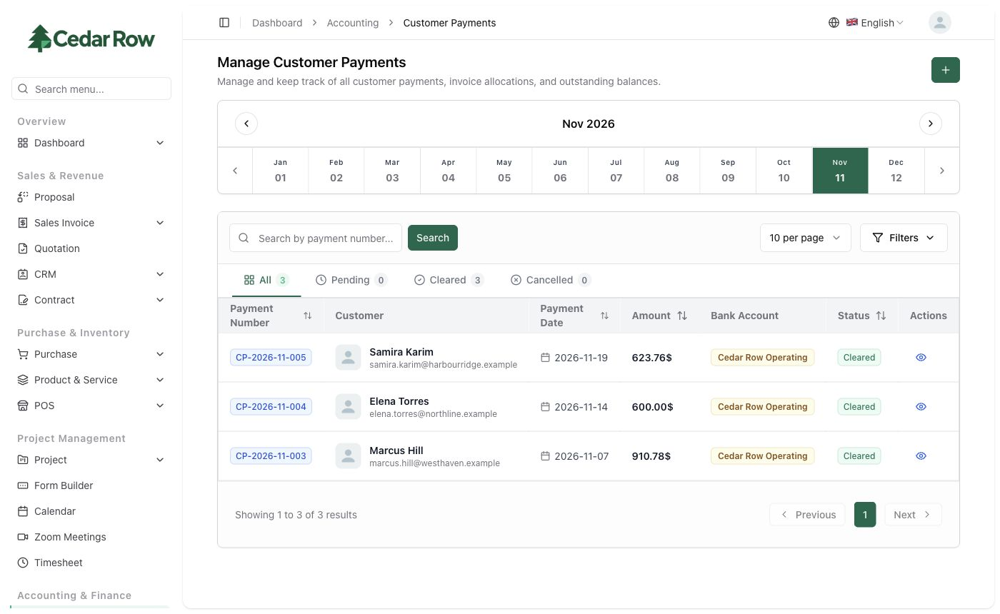
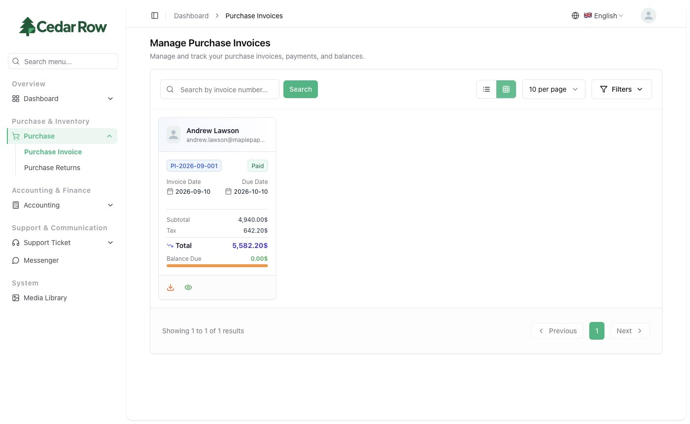
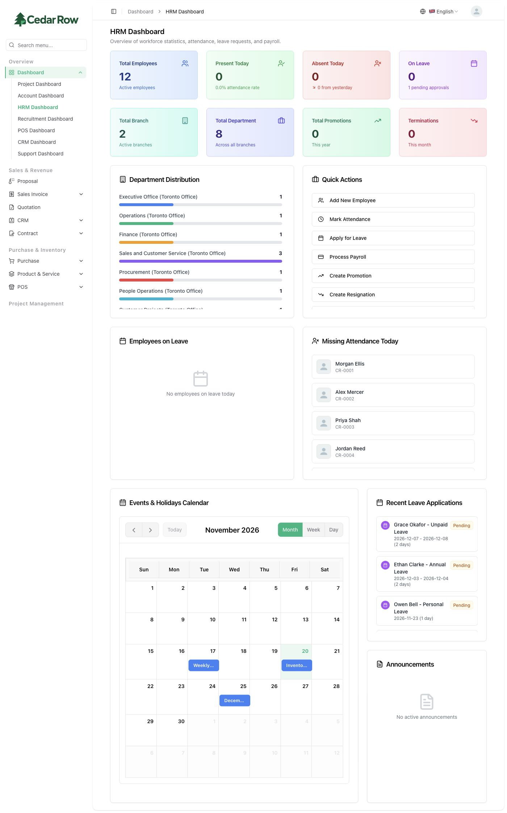
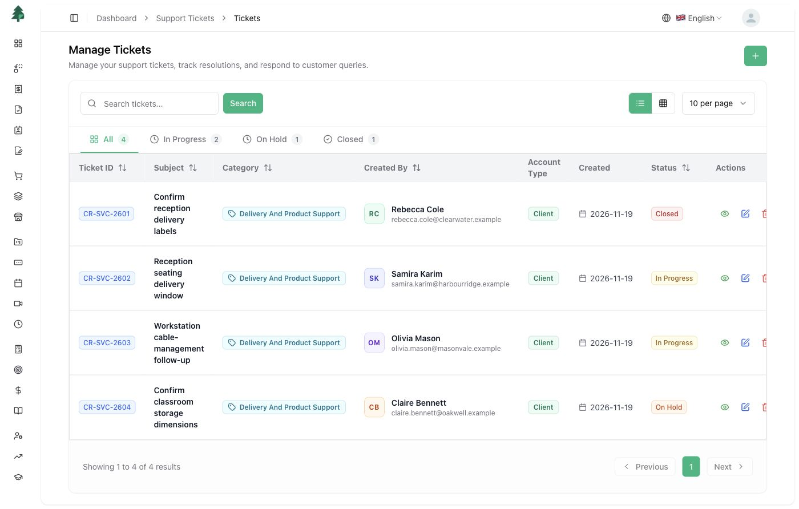

# Cedar Row live ERP showcase

These screenshots show the live Cedar Row ERP on a VPS, where staff, customers, and vendors sign in with assigned accounts. Each section connects what they see to the Azure deployment I built and verified. [Azure landing zone](architecture/01-overview.png) · [Azure deployment evidence](../README.md#deployment-evidence)

[Sales and payments](#sales-and-payments) · [Purchasing and inventory](#purchasing-and-inventory) · [Customer and vendor accounts](#customer-and-vendor-accounts) · [Projects, people, and support](#projects-people-and-support)

## Sales and payments

**Account dashboard.** Staff review customer payments, vendor payments, and expenses. In Azure, the browser connected to the ERP on Container Apps over HTTPS, and the app read the underlying records from MySQL over a private network. [Network diagram](architecture/02-network.png) · [Staff entry page](assets/live-erp/staff-workspace.jpg)

**Sales register and invoice detail.** Staff can check which sales have been posted and what is owed. In the Azure deployment, posting a sale saved the invoice, stock change, and accounting entries in one MySQL transaction. That kept the records in sync and saved a pending notification event alongside them. [Invoice flow](architecture/03-event.png)

**Notification processing.** A scheduled job sent pending invoice events to Azure Service Bus. The worker recorded a processing receipt in Azure Table Storage. During the outage drill, the ERP posted an invoice while the worker was paused, then Log Analytics traced the event through to its receipt after the worker restarted. [Azure outage evidence](../README.md#notification-outage-and-recovery)

**Payments and ledger.** The payment register shows money received from customers. The ledger shows how the ERP records that payment against the customer’s balance. MySQL held the financial records behind both views. [MySQL recovery evidence](../README.md#data-recovery-drills)

## Purchasing and inventory

**Purchase invoices and inventory.** Purchase invoices record what the warehouse bought. The item catalog shows stock on hand for those products. Both types of records lived in private MySQL in the Azure deployment. [Network diagram](architecture/02-network.png)

**Data recovery.** The Azure setup used MySQL for business records and Blob Storage for uploads. I verified a logical restore of isolated database records and recovered a deleted file from an earlier blob version. [Recovery design](architecture/07-recovery.png) · [Restore evidence](../README.md#data-recovery-drills)

## Customer and vendor accounts

**Customer and vendor views.** Each account shows its own invoices. In Azure, each workload had a managed identity with its own permissions for resources such as Key Vault, Service Bus, or storage. [Identity diagram](architecture/04-access.png) · [Customer payment dashboard](assets/live-erp/customer-dashboard.jpg)

## Projects, people, and support

Projects, people, and support run inside the ERP web app. In Azure, I used Log Analytics to inspect app logs and configured alerts for application errors, MySQL CPU, and messages that failed processing. [Monitoring diagram](architecture/06-operations.png) · [Alert evidence](../README.md#azure-monitor-alerts)

**Project board.** Staff track customer work, deadlines, and task progress.

**People dashboard.** Staff review department staffing and pending leave requests across branches.

**Support queue.** Staff track customer requests and follow up on delivery issues.

