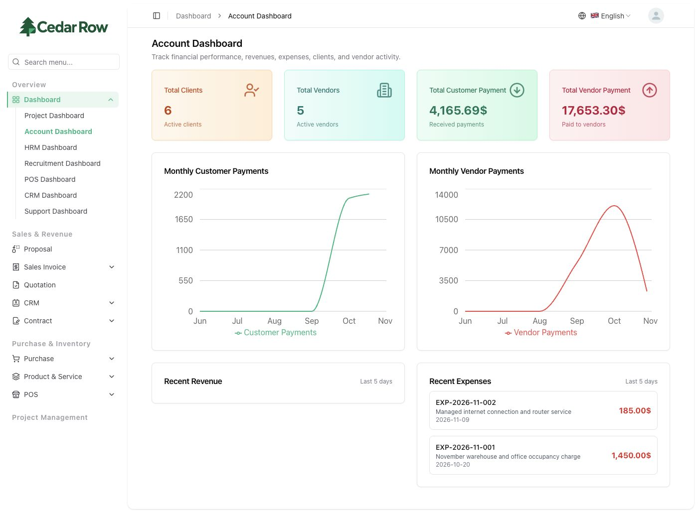
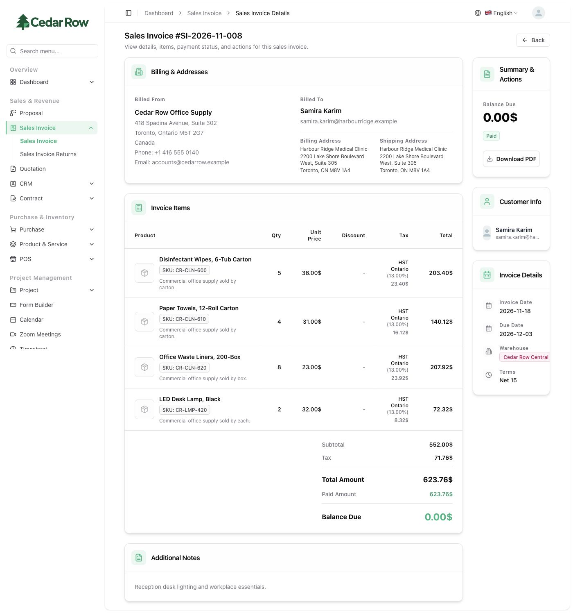
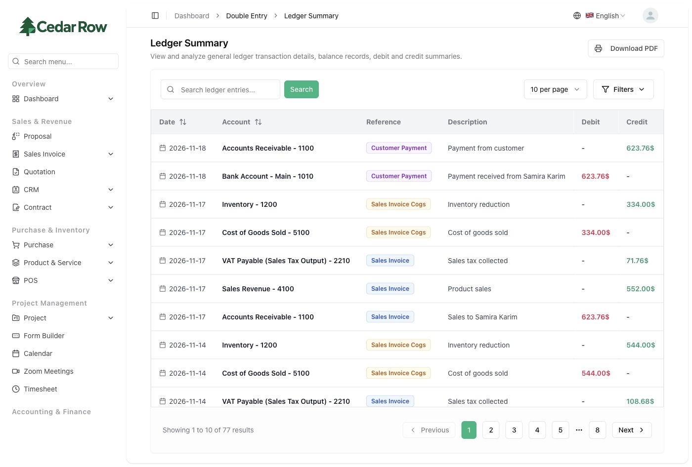
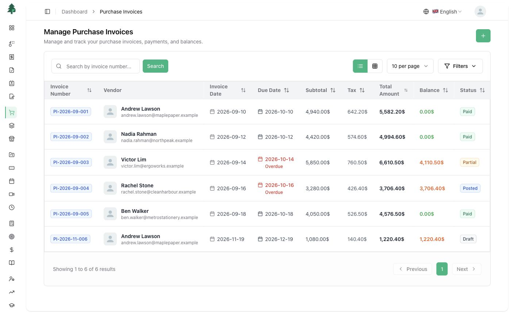
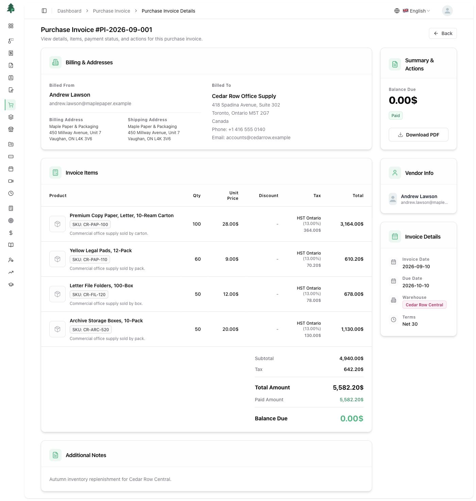
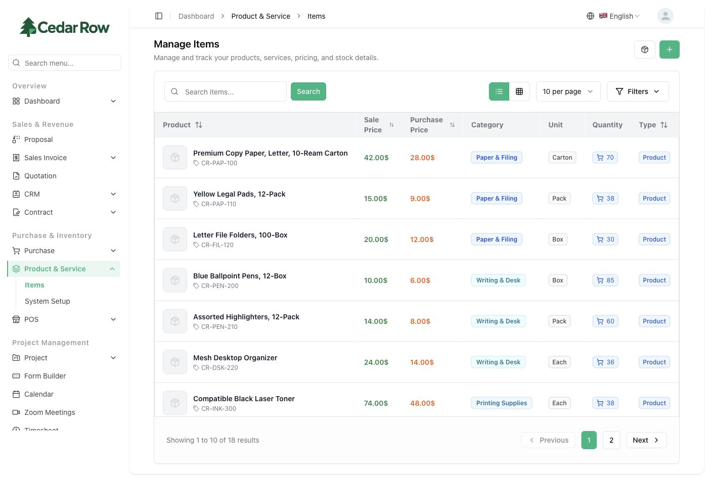
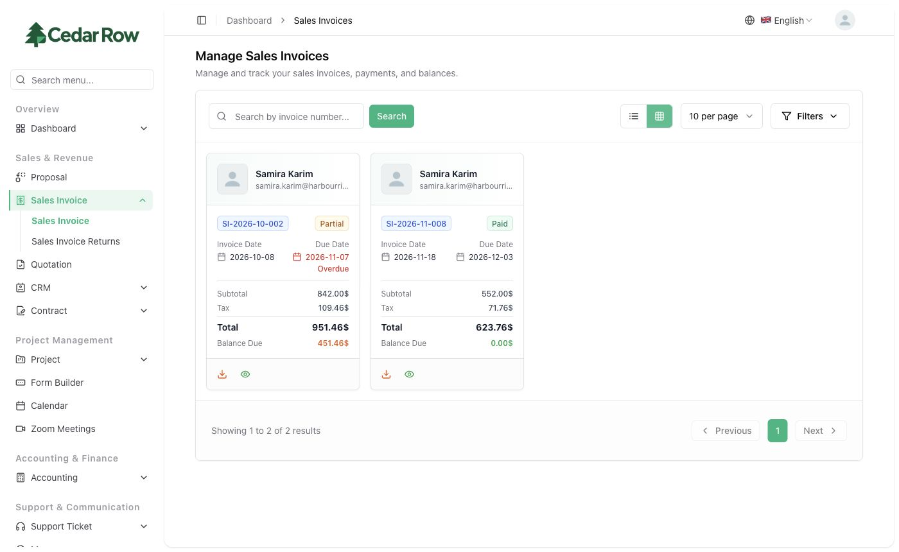
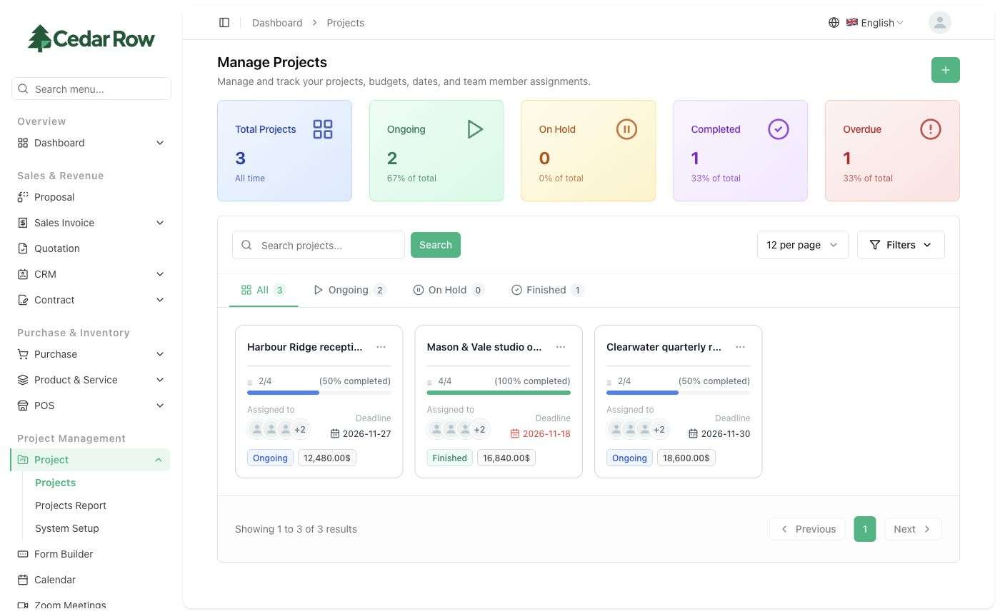

# Cedar Row live ERP showcase

These screenshots show existing wholesale records in the live Cedar Row ERP. Staff, customers, and vendors sign in to their assigned accounts. [Project overview](../README.md) · [Azure deployment and recovery evidence](../README.md#deployment-evidence)

[Sales and payments](#sales-and-payments) · [Purchasing and inventory](#purchasing-and-inventory) · [Customer and vendor accounts](#customer-and-vendor-accounts) · [Projects, people, and support](#projects-people-and-support)

## Sales and payments

The **Account Dashboard** shows customer receipts, vendor payments, and recent expenses. [Staff entry page](assets/live-erp/staff-workspace.jpg)

The **sales register** shows paid, partially paid, and posted invoices with their remaining balances.

**Invoice `SI-2026-11-008`** totals $623.76, including $71.76 in tax. The customer paid the full balance.

**Payment `CP-2026-11-005`** is marked Cleared for the same customer and amount.

The **ledger** shows a $623.76 debit to the bank account and a matching credit to accounts receivable. It also shows entries for sales, tax, inventory, and cost of goods sold.

## Purchasing and inventory

The **purchase register** shows vendor invoices at draft, posted, partial, and paid stages.

**Invoice `PI-2026-09-001`** records a $5,582.20 replenishment purchase for Cedar Row Central. It includes 100 cartons of copy paper, SKU `CR-PAP-100`, and shows zero due.

The **item catalog** lists that same SKU alongside other products, with current stock quantities and purchase and sale prices.

## Customer and vendor accounts

The **customer account** shows two of its own invoices. The same `SI-2026-11-008` from the staff view is paid, and an older invoice has $451.46 outstanding. [Customer payment dashboard](assets/live-erp/customer-dashboard.jpg)

The **vendor account** shows its paid copy of `PI-2026-09-001` with zero due.

## Projects, people, and support

The **project board** shows ongoing and finished customer work, task progress, deadlines, and budgets.

The **people dashboard** shows two branches, department staffing, and pending leave requests.

The **support queue** shows customer requests for delivery, product, and order follow-up, with their current status.

